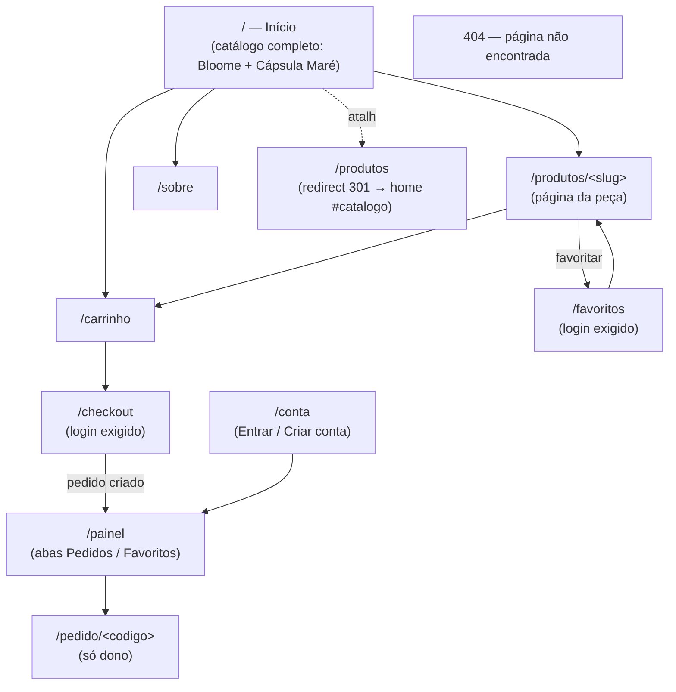

# Arquitetura da Informação — Bloome

Mapa do site, fluxo da compra e justificativa do menu atuais; roteiros de **card sorting** e **tree testing** prontos para aplicar.

Data: 2026-11-27 · Equipe Bloome.

---

## 1. Mapa do site (atual)



Rotas reais confirmadas em `app.py`: `/`, `/produtos` (redirect), `/produtos/<slug>`, `/carrinho`, `/checkout`, `/pedido/<codigo>`, `/favoritos`, `/sobre`, `/conta`, `/painel`.

---

## 2. Fluxo da compra (tarefa principal)

```mermaid
flowchart TD
    A[Abre a home] --> B[Vê os dois catálogos]
    B --> C[Toca numa peça → /produtos/slug]
    C --> D{Escolhe cor e quantidade}
    D --> E[Adiciona ao carrinho]
    E --> T[Toast confirma + badge do carrinho]
    T --> F[Vai ao /carrinho]
    F --> G[Ajusta quantidade / remove]
    G --> H{Clicou Finalizar}
    H -->|não logado| I[/conta: entrar ou criar]
    I -->|next=checkout| J[/checkout]
    H -->|logado| J
    J --> K[Etapa 1: Entrega]
    K --> L[Etapa 2: Pagamento]
    L --> M[Etapa 3: Confirmação]
    M --> N[Pedido em transação + estoque baixado]
    N --> O[Modal de sucesso → /painel]
    O --> P[Detalhe do pedido /pedido/codigo]
```

Regras embutidas: dinheiro só no servidor; estoque validado antes de criar o pedido; pagamento simulado aprova e deixa o pedido "em preparação" (ADR-029); carrinho guarda só `id_variacao` + quantidade (ADR-027).

---

## 3. Menu atual e justificativa

Definido em `templates/base.html:19-24` (itens base) e montado condicionalmente pelo estado da sessão.

| Item | Aparece quando | Por quê |
| --- | --- | --- |
| **Início** | sempre | Home = catálogo completo (ADR-034). Ponto de partida. |
| **Sobre** | sempre | Contexto da marca/artesania; página institucional. |
| **Favoritos** | **só logado** | Favoritos são por cliente, guardados em `bloome.favoritos` (ADR-032); sem conta não há o que mostrar. |
| **Carrinho** (ícone) | sempre | Ação de compra sempre acessível; contagem via badge e `aria-label` ("Carrinho, N itens"). |
| **Entrar** | **só deslogado** | Leva a `/conta` (aba Entrar). |
| **Nome → painel** + **Sair** | **só logado** | Substitui "Entrar" quando há sessão; "Sair" é discreto. |

**Decisões de IA observadas:**
- Catálogo **na home**, e `/produtos` virou redirect 301 (ADR-034) — reduz um clique até a peça.
- Preferência por **icon+label acessível** no carrinho (nome por extenso no `aria-label`).
- "Favoritos" só logado é **deliberado** (evita página vazia/erro), mas cria variação de menu conforme login — ponto a validar no card sorting.

---

## 4. Card sorting — A EXECUTAR

Objetivo: descobrir como o público agrupa e **nomeia** as áreas, para revisar o menu.

### 4.1 Cartões (10)
1. Início
2. Catálogo Bloome
3. Cápsula Maré
4. Página da peça
5. Carrinho
6. Checkout (finalizar pedido)
7. Favoritos
8. Meus pedidos (painel)
9. Minha conta / Entrar
10. Sobre a Bloome

### 4.2 Protocolo
- **Participantes:** 6–10 do perfil cliente (18–35, compram por celular).
- **Tipo:** aberto (a pessoa cria grupos e dá nome) → depois fechado, se quiser validar.
- **Tarefa:** "Agrupe estes cartões como faria sentido para você e dê um nome a cada grupo."
- **Registro:** foto da mesa/planilha com os grupos; nomes escolhidos por grupo.
- **Análise:** matriz de co-ocorrência; grupos recorrentes; nomes mais usados vs. nomes atuais do menu.
- **Critério de decisão:** se ≥50% agrupam "Meus pedidos" e "Favoritos" juntos, considerar uma área "Minha conta" única; se muitos não entendem "Cápsula Maré", revisar rótulo.
- **Entrega:** planilha + síntese.

---

## 5. Tree testing — A EXECUTAR

Objetivo: testar a **árvore** (sem visual) para ver se as pessoas acham o que procuram.

### 5.1 Árvore de teste
```
Início
├── Catálogo (Bloome / Cápsula Maré) → peça
├── Sobre
├── Carrinho → Checkout → Confirmação
├── Favoritos
└── Minha conta → Meus pedidos → Detalhe do pedido
```

### 5.2 Tarefas (5)
1. **Achar uma peça:** "Onde você procuraria o colar 'Cordão Coração'?" (resposta: Início/Catálogo → peça)
2. **Andamento do pedido:** "Onde você veria se seu pedido já foi preparado?" (painel → Meus pedidos → detalhe)
3. **Adicionar ao carrinho:** "Onde você colocaria uma peça para comprar depois?" (peça → carrinho)
4. **Opções de entrega:** "Onde você descobriria como receber o pedido?" (checkout → etapa Entrega)
5. **Favoritos:** "Onde estariam as peças que você marcou com coração?" (Favoritos)

### 5.3 Métricas por tarefa
- **Sucesso** (achou o destino certo): sim/não.
- **Caminho percorrido** vs. caminho esperado.
- **Tempo** até o clique final.
- **Dúvida** declarada ("fiquei em dúvida entre X e Y").

### 5.4 Protocolo
- **Participantes:** 8–12, idealmente diferentes do card sorting.
- **Critério:** ≥75% de sucesso na tarefa 1 e 3 (fluxo principal) para considerar a árvore saudável; abaixo disso, revisar rótulos/posição.
- **Ferramenta:** OptimaItree/Optimal Workshop ou árvore em papel com um mediador.
- **Entrega:** tabela tarefa × participante (sucesso/tempo/caminho) + conclusão.

---

## 6. Resumo

| Item | Status |
| --- | --- |
| Mapa do site | **FEITO** (diagrama) |
| Fluxo da tarefa principal | **FEITO** (diagrama) |
| Menu atual + justificativa | **FEITO** |
| Card sorting (10 cartões) | A EXECUTAR (roteiro pronto) |
| Tree testing (5 tarefas) | A EXECUTAR (roteiro pronto) |
